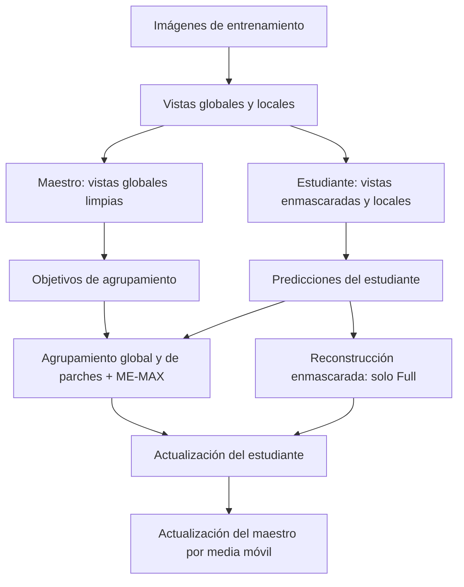
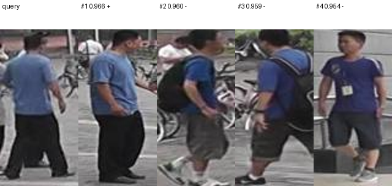
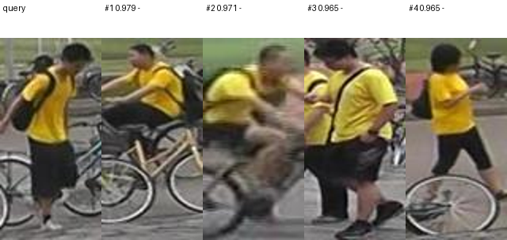
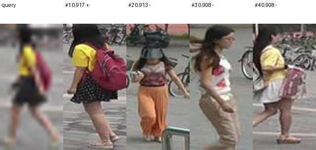
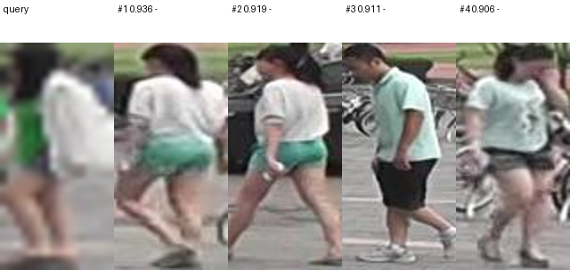

# MaskCluster SSL

**Aprendizaje autosupervisado para reidentificación de personas y evaluación ante pérdida de resolución.**

Este proyecto adapta el método de *Investigating Self-Supervised Methods for Label-Efficient Learning* a la recuperación de imágenes de personas. El modelo aprende representaciones visuales sin utilizar etiquetas de identidad durante el entrenamiento y, en la evaluación, ordena una galería según su similitud con una imagen de consulta.

El estudio compara dos arquitecturas entrenadas por separado: **Full**, con reconstrucción de regiones enmascaradas, y **Ablation — Sin MIM**, que elimina ese objetivo y conserva el agrupamiento visual global y de parches. Ambas se evaluaron sobre el conjunto de prueba, con consultas en resolución original y reducida.

## Modelo base y estudio de ablación

En el diseño experimental de esta entrega, **Full es el modelo base o de referencia**: conserva los componentes centrales del método del artículo, con las adaptaciones al problema de reidentificación descritas en este documento. **Sin MIM es su ablación**, entrenada de nuevo sin el objetivo de reconstrucción enmascarada y manteniendo la configuración común.

La comparación del laboratorio es **Full frente a Sin MIM**. Para cada arquitectura se evaluaron maestro y estudiante, y la validación seleccionó al estudiante. Full designa el método completo adaptado; no implica una reproducción literal de todos los detalles o resultados del artículo.

## Arquitecturas comparadas

| Componente | Full | Ablation — Sin MIM |
|---|:---:|:---:|
| Codificador ViT-S/16 | Sí | Sí |
| Aprendizaje maestro–estudiante | Sí | Sí |
| Agrupamiento global | Sí | Sí |
| Agrupamiento de parches | Sí | Sí |
| Regularización ME-MAX | Sí | Sí |
| Objetivo de reconstrucción enmascarada (MIM) | Sí | No |

La ablación permite evaluar la contribución del objetivo de reconstrucción. No consiste en desactivarlo después de entrenar: la versión Sin MIM tiene su propio entrenamiento y sus propios pesos.

Durante el aprendizaje, el **estudiante** se actualiza mediante gradientes y el **maestro** mediante una media móvil de sus pesos. En la evaluación se compararon ambos codificadores; la validación seleccionó al estudiante en las dos arquitecturas.



Cada imagen se representa mediante un vector CLS de **384 dimensiones**, normalizado con norma L2. La recuperación utiliza similitud coseno.

## Datos y separación de etapas

| Partición | Imágenes | Uso |
|---|---:|---|
| Entrenamiento | 11 043 | Aprendizaje autosupervisado de los pesos |
| Consultas de validación | 100 | Selección de pesos y codificador |
| Galería de validación | 1 793 | Referencia para la selección |
| Consultas de prueba | 3 368 | Evaluación final |
| Galería de prueba | 19 732 | Recuperación final |

Los archivos `training.h5`, `validation.h5` y `testing.h5` se organizan en `Input/raw/`. Las imágenes se almacenan como RGB `uint8`, con orden de dimensiones canales × alto × ancho.

- **Resolución original:** 128 × 64 píxeles.
- **Consultas de baja resolución:** 32 × 16 píxeles, redimensionadas a 128 × 64 al entrar al codificador.
- **Galería:** se conserva en resolución original en ambas condiciones.

El entrenamiento no utiliza identidades como objetivos. Las etiquetas de identidad y cámara se emplean para calcular las métricas de recuperación. La prueba final no se utiliza para actualizar pesos ni seleccionar el codificador.

## Configuración experimental

| Parámetro | Valor |
|---|---|
| Inicialización | Desde cero |
| Arquitectura | ViT-S/16: 12 bloques y 6 cabezas de atención |
| Dimensión de representación | 384 |
| Tamaño de parche | 16 × 16 |
| Vistas por imagen | 2 globales y 4 locales |
| Tamaño de las vistas locales | 96 × 48 |
| Prototipos de agrupamiento | 1 024 |
| Proporción de enmascaramiento | 50 % |
| Capas utilizadas para reconstrucción | 6, 8, 10 y 12 |
| Tamaño de lote de entrenamiento | 128 imágenes |
| Optimizador | AdamW |
| Tasa de aprendizaje inicial / mínima | 0.0001 / 0.000001 |
| Regularización de pesos | 0.05 |
| Calentamiento | 2 épocas |
| Media móvil del maestro | 0.996 → 1.0 |
| Precisión mixta | Activada durante el entrenamiento |
| Semilla | 42 |
| Épocas ejecutadas por arquitectura | 30 |

Los entrenamientos se ejecutaron en Khipu sobre una RTX A6000 compartida. Cada arquitectura completó **2 580 pasos de optimización**. Los pesos evaluados proceden de las primeras 30 épocas de un calendario de aprendizaje previsto para 40; se conserva ese calendario en la configuración y los registros originales.

La adaptación utiliza entradas rectangulares y un decodificador MLP con pérdida L1 sobre las regiones enmascaradas. Por las diferencias de tarea, configuración y presupuesto, los resultados no constituyen una reproducción numérica de los experimentos del artículo.

## Protocolo de evaluación

Los pesos del maestro y del estudiante se seleccionan de forma independiente según el promedio del mAP de validación en las dos resoluciones. A continuación se elige el codificador con mayor puntuación de validación. **El estudiante fue el seleccionado para Full y Sin MIM**, en ambos casos con pesos de la época 25.

La evaluación aplica las exclusiones del protocolo Market-1501: elimina imágenes con identidad descartada (`-1`) y coincidencias de la misma identidad y cámara. Las 3 368 consultas de prueba tuvieron positivos válidos; ninguna fue excluida del cálculo.

Se reportan:

- **mAP — promedio de la precisión media:** resume la posición de las coincidencias correctas a lo largo de la lista recuperada.
- **Rank-1, Rank-5 y Rank-10:** porcentaje de consultas con al menos una coincidencia correcta entre los primeros 1, 5 o 10 resultados.
- **Caída de mAP:** diferencia entre la condición original y la de baja resolución, expresada en puntos porcentuales.

## Resultados finales

[Guía de los requisitos de la entrega](docs/entrega_laboratorio.md) · [Curvas, resultados y configuraciones efectivas](docs/resultados_experimento.md).

Resultados de los **estudiantes seleccionados mediante validación**. Todas las métricas de la tabla se expresan en porcentaje.

| Arquitectura | Resolución de consulta | mAP (%) | Rank-1 (%) | Rank-5 (%) | Rank-10 (%) |
|---|---|---:|---:|---:|---:|
| Full | Original | 2.110 | 4.899 | 12.559 | 18.141 |
| Ablation — Sin MIM | Original | **2.162** | **5.523** | **13.450** | **18.379** |
| Full | Baja resolución | 1.899 | 3.949 | 11.461 | 15.736 |
| Ablation — Sin MIM | Baja resolución | **1.975** | **4.602** | **12.084** | **16.865** |

| Arquitectura | Mejor mAP medio de validación del estudiante (%) | Caída de mAP en prueba (puntos porcentuales) |
|---|---:|---:|
| Full | 10.052 | 0.211 |
| Ablation — Sin MIM | 10.732 | 0.188 |

**Sin MIM obtuvo mejores resultados en las cuatro métricas y en ambas resoluciones.** Su ventaja de mAP frente a Full fue de 0.053 puntos porcentuales en resolución original y de 0.076 en baja resolución. En este experimento, incorporar reconstrucción no produjo una mejora de recuperación ni una mayor resistencia a la reducción de resolución.

Las pérdidas de agrupamiento y reconstrucción disminuyeron durante el entrenamiento, lo que muestra que la optimización avanzó. Sin embargo, el rendimiento final sigue siendo bajo: reducir las pérdidas no se tradujo en una separación suficiente entre identidades. Las diferencias observadas describen estas dos ejecuciones con una semilla común; no establecen que eliminar MIM sea superior en cualquier configuración.

## Ejemplos de recuperación

Los siguientes paneles corresponden al **estudiante Full sobre el conjunto de prueba**. La primera imagen es la consulta y las siguientes son las imágenes de galería ordenadas por similitud. No representan una secuencia temporal.

### Análisis completo de aciertos y fallos

La documentación incluye **cinco aciertos y cinco fallos por arquitectura y por resolución**: cuarenta paneles en total, con la posición de la primera coincidencia correcta, la similitud del primer resultado y una explicación individual de los errores.

| Arquitectura evaluada | Originales | Baja resolución | Documento |
|---|---|---|---|
| Full · estudiante | 5 aciertos + 5 fallos | 5 aciertos + 5 fallos | [Ver ejemplos y análisis](docs/resultados_full.md) |
| Ablation — Sin MIM · estudiante | 5 aciertos + 5 fallos | 5 aciertos + 5 fallos | [Ver ejemplos y análisis](docs/resultados_no_mim.md) |

Los cuatro paneles siguientes son una vista previa. Los documentos enlazados contienen los cuarenta casos y el [índice verificable de ejemplos](docs/indice_ejemplos.csv).

### Acierto con resolución original



### Fallo con resolución original



### Acierto con baja resolución



### Fallo con baja resolución



En los paneles, `+` indica una coincidencia de identidad y `−` una identidad diferente. **Acierto** significa que el primer resultado es correcto; los demás candidatos del panel pueden ser incorrectos. **Fallo** significa que el primer resultado es incorrecto, aunque una coincidencia válida puede aparecer más abajo en la clasificación. La puntuación mostrada es similitud coseno, no una probabilidad de acierto. Estos casos ilustran resultados individuales y no sustituyen las métricas del conjunto completo.

## Explorador de la arquitectura del artículo

[Ver el archivo del explorador interactivo](Maskcluster_architecture.html). Para utilizar sus controles, descarga el HTML y ábrelo en un navegador, o accede a la [versión web cuando GitHub Pages esté habilitado](https://lvilla60.github.io/maskcluster-ssl/Maskcluster_architecture.html).

El explorador ilustra el **método del artículo original**, con entradas de 224 × 224, diez vistas locales y 8 192 prototipos, además de sus tareas de transferencia. No representa los resultados experimentales de este repositorio. Nuestra adaptación utiliza entradas de 128 × 64, cuatro vistas locales de 96 × 48 y 1 024 prototipos, con evaluación de reidentificación. El HTML distingue ambos contextos y sus ejemplos de código son esquemáticos.

## Uso del proyecto

Se recomienda Python 3.11 en un entorno aislado y una instalación de PyTorch adecuada para el equipo. El entorno utilizado en Khipu fue Python 3.11.11, PyTorch 2.11.0 con CUDA 12.8 y torchvision 0.26.0.

Desde la raíz del repositorio:

```bash
python -m pip install -e ".[dev]"
python -m pip check
```

Verificación del código y comprobación acotada con datos reales:

```bash
python -B -m pytest tests -q -p no:cacheprovider
python -B scripts/verify_cpu_smoke.py --config configs/smoke_staged_review.yaml --device cpu
```

Para comprobar un entorno con GPU, se utiliza `--device cuda` en lugar de `--device cpu`.

El entrenamiento recibe una configuración YAML. Antes de iniciar una nueva ejecución, deben definirse en ella el tamaño de lote, el presupuesto de épocas, los datos y el directorio de salida.

```bash
python -B scripts/train.py --config configs/train.yaml --variant full
python -B scripts/train.py --config configs/train.yaml --variant no_mim
```

Los comandos anteriores inician nuevas ejecuciones con los valores del archivo indicado. Las configuraciones guardadas dentro de cada ejecución documentan los valores usados para los resultados de este README.

Para ejecutar por etapas y continuar desde una época completada, se mantiene fijo el presupuesto total en la configuración:

```bash
python -B scripts/train.py --config CONFIG.yaml --max-epochs-per-invocation 10
python -B scripts/train.py --config CONFIG.yaml --resume RUN/last.pt --max-epochs-per-invocation 10
```

Evaluación de un estudiante seleccionado y exportación de su historial; `RUN` representa el directorio real del entrenamiento y los directorios de salida deben ser nuevos:

```bash
python -B scripts/evaluate.py --checkpoint RUN/best_student.pt --data Input/raw/testing.h5 --split testing --encoder student --output outputs/evaluations/full_student --device cuda
python -B scripts/export_history.py --run RUN --output outputs/figures/full
```

## Organización y trazabilidad

| Directorio | Contenido |
|---|---|
| `configs/` | Configuraciones de entrenamiento y verificación |
| `src/maskcluster_ssl/data/` | Lectura HDF5, transformaciones y procedencia de datos |
| `src/maskcluster_ssl/models/` | Codificadores, arquitectura maestro–estudiante y reconstrucción |
| `src/maskcluster_ssl/losses/` | Agrupamiento, ME-MAX y reconstrucción |
| `src/maskcluster_ssl/training/` | Optimización, validación y recuperación de ejecuciones |
| `src/maskcluster_ssl/evaluation/` | Representaciones, métricas, clasificaciones y paneles |
| `scripts/` | Entrenamiento, evaluación y exportación |
| `tests/` | Pruebas unitarias e integración |
| `assets/results/` | Ejemplos visuales del README |
| `Input/raw/` | Datos HDF5 locales |
| `outputs/` | Historiales, pesos y resultados generados |

Cada ejecución conserva su configuración, historial por época, métricas de validación, mejores pesos y estado para reanudar. Los registros incluyen pasos, tiempos, rendimiento y picos de memoria CUDA del proceso. Los datos y los pesos evaluados se identifican mediante firmas SHA-256.

La evaluación final exporta métricas JSON/CSV, clasificaciones por consulta y ejemplos de aciertos y fallos. Los archivos de datos y los pesos del modelo se mantienen fuera del repositorio.

## Referencia

Nandam et al. (2025). *Investigating Self-Supervised Methods for Label-Efficient Learning*. International Journal of Computer Vision, 133, 4522–4537. [https://doi.org/10.1007/s11263-025-02397-4](https://doi.org/10.1007/s11263-025-02397-4).
