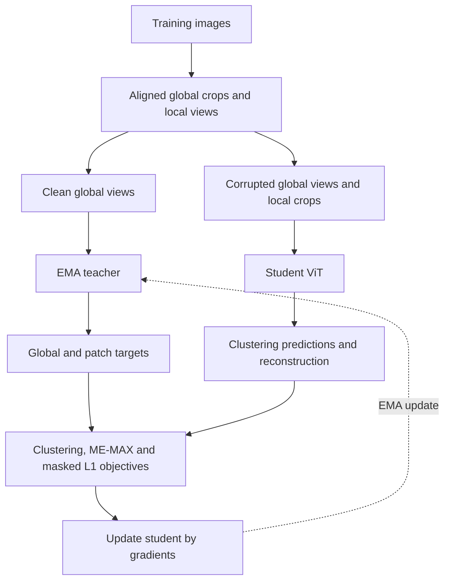

# MaskCluster SSL

### Learning person representations without identity labels

A self-supervised person re-identification project that combines **visual clustering, teacher–student learning, and masked image reconstruction**. Given a person image, the model produces an embedding to retrieve matching people across cameras, viewpoints, backgrounds, and image resolutions.

Built on Market-1501, this project adapts *Investigating Self-Supervised Methods for Label-Efficient Learning* to image-only retrieval. The central method is implemented locally with PyTorch primitives.

**Current milestone:** CPU implementation and bounded integration checks completed. **27 tests pass**; two checks remain skipped for CUDA and Windows worker permissions. GPU validation, training experiments, and final test evaluation are next.

## 1. Project objectives

- Learn transferable visual features without identity supervision during training.
- Compare an EMA teacher with its gradient-trained student.
- Measure the contribution of patch clustering and masked reconstruction.
- Evaluate retrieval under original and low-resolution query conditions.
- Produce reproducible metrics, rankings, and visual error analysis.

Identity and camera metadata are used only for auditing and evaluation. They are not model inputs or training targets. Latent clustering prototypes do not represent identity labels.

## 2. Architecture overview



The teacher provides targets from clean global views. The student learns from corrupted global views and local crops. Global clustering encourages consistency across views; aligned patch clustering captures local structure; reconstruction predicts hidden RGB content. ME-MAX encourages diverse cluster assignments.

At retrieval time, either encoder produces a **384-dimensional CLS embedding**, normalized to unit L2 length. Images are ranked by cosine similarity.

| Component | Current configuration |
|---|---|
| Backbone | ViT-S/16, initialized from scratch |
| Transformer | 12 layers, 384 dimensions, six attention heads |
| Global input | 128 × 64 RGB; 32 patch tokens plus CLS |
| Local input | 96 × 48 RGB |
| Views | Two global crops and four local crops |
| Prototypes | 1,024 latent clusters |
| Masking | Configurable; initial ratio 50% |
| Reconstruction | MLP decoder from summed layers 6, 8, 10 and 12 |
| Teacher update | Exponential moving average of the student |

Crop count, prototype count, loss weights, and training budget remain provisional until the pilot.

## 3. Experimental variants

| Variant | Global clustering | Patch clustering | Reconstruction |
|---|:---:|:---:|:---:|
| `baseline` | ✓ | — | — |
| `no_mim` | ✓ | ✓ | — |
| `full` | ✓ | ✓ | ✓ |

Each variant includes the ME-MAX terms corresponding to its active clustering objectives. Shared components start with identical weights. Separate deterministic streams control sample order, crops, photometry, masks, and corruption across variants.

The `no_mim` experiment is a **retrained ablation** of reconstruction. Teacher and student are evaluated separately for all three variants.

## 4. Dataset and evaluation protocol

| Partition | Images | Role |
|---|---:|---|
| Training | 11,043 | Self-supervised parameter updates |
| Validation queries | 100 original + 100 low-resolution versions | Configuration and checkpoint selection |
| Validation gallery | 1,793 | Retrieval evaluation |
| Test queries | 3,368, with original/LR versions | Reserved final evaluation |
| Test gallery | 19,732 | Reserved final evaluation |

Training and validation counts were audited. Test counts follow the laboratory specification; the test partition remains unopened.

Place the supplied HDF5 files under `Input/raw/`, or configure their locations. Readers open files in read-only mode and manage HDF5 handles per process.

Both evaluation conditions use the **same selected checkpoint and original gallery**. The pipeline reports **mAP, Rank-1, Rank-5, Rank-10**, and the mAP drop in percentage points. Market-1501 exclusions remove junk and same-identity/same-camera gallery entries; queries without valid positives are excluded from metric denominators.

Teacher and student checkpoints are selected separately using mean validation mAP across original and low-resolution queries. Testing is used only after configuration and checkpoint selection are frozen.

## 5. Adaptation of the reference method

The implementation preserves the teacher–student mechanism, global and patch clustering, ME-MAX, and masked reconstruction. It adapts the original method through:

- Rectangular person crops instead of square natural-image inputs.
- An MLP patch decoder instead of the original convolutional reconstruction head.
- Mean masked L1 with FP32 reductions instead of the literal summed loss; relative weights require validation.
- Moderate brightness, contrast, saturation, and occasional grayscale augmentations to balance invariance with appearance cues.
- A configurable dense visible-attention implementation following the information flow of equations 9–11. CLS is treated as visible; masked tokens retain queries but are excluded from keys and values. No computational speedup is claimed.

Standard attention remains available as an alternative. This is an adaptation for person retrieval, not a reproduction of the paper's supervised downstream experiments or published scores.

## 6. Repository layout

| Location | Purpose |
|---|---|
| `configs/` | Training and bounded verification settings |
| `src/maskcluster_ssl/data/` | HDF5 readers, views, sampling, and provenance |
| `src/maskcluster_ssl/models/` | ViT, teacher–student model, and reconstruction |
| `src/maskcluster_ssl/losses/` | Clustering, ME-MAX, and masked L1 |
| `src/maskcluster_ssl/training/` | Optimization, validation, checkpoints, and runtime metadata |
| `src/maskcluster_ssl/evaluation/` | Embeddings, retrieval metrics, rankings, and panels |
| `scripts/` | Audit, training, evaluation, and verification entry points |
| `tests/` | Unit and integration checks |
| `slurm/` | Reserved for target-cluster job scripts |
| `Input/`, `outputs/` | Local datasets and generated artifacts |

Datasets, checkpoints, temporary files, and internal architecture notes are excluded from version control. Run commands from the repository root.

## 7. Installation and verification

Use Python 3.11 in an isolated environment. Activate the existing project environment before running commands:

```bash
conda activate MaskCluster_SSL
python -m pip install -e ".[dev]"
python -m pip check
```

The verified Windows CPU environment uses PyTorch `2.14.1+cpu` and torchvision `0.29.1+cpu`. Direct dependency pins are recorded in `requirements-lock-windows-cpu.txt`; runs also record the full installed-package inventory.

Khipu requires a separate Linux/GPU environment. Select the appropriate PyTorch CUDA build for the assigned hardware before installing the project and record the resulting environment. The Windows CPU pins are not a verified Linux/CUDA lock.

Run the test suite and bounded real-data check:

```bash
python -B -m pytest tests -q -p no:cacheprovider
python -B scripts/verify_cpu_smoke.py --config configs/smoke_cpu.yaml --device cpu
```

On the target GPU environment, repeat verification with `--device cuda`.

## 8. Training and checkpoint recovery

After fixing a common pilot budget, launch each variant separately:

```bash
python -B scripts/train.py --config configs/train.yaml --variant baseline
python -B scripts/train.py --config configs/train.yaml --variant no_mim
python -B scripts/train.py --config configs/train.yaml --variant full
```

The supplied training configuration is provisional; these commands start training, not a smoke test. Use `--resume PATH` to continue from a completed-epoch checkpoint.

Checkpoints retain model, optimizer, AMP scaler, counters, best scores, configuration, and random states. Training and validation files are identified by SHA-256 signatures. Relocated data paths are accepted when file signatures match; incompatible scientific configuration changes are rejected. Enabling AMP from a CPU checkpoint without scaler state initializes a new scaler and records the transition.

CPU continuation is tested. Cross-device numerical equivalence is not guaranteed, and an interrupted epoch restarts from its checkpoint boundary.

## 9. Evaluation and visual analysis

Evaluate the selected teacher checkpoint on validation; replace `RUN` with the actual run directory:

```bash
python -B scripts/evaluate.py --checkpoint outputs/runs/RUN/best_teacher.pt --data Input/raw/validation.h5 --split validation --encoder teacher --output outputs/evaluations/RUN_teacher
```

Use the student checkpoint with `--encoder student` for its comparison. Each call evaluates both query resolutions and exports metrics, rankings, and deterministic panels of up to five Rank-1 successes and five failures per condition. Reports state the available counts when fewer cases exist; interpretation remains a separate analysis step.

Reports identify the actual HDF5 file, gallery signature, group sizes, and preprocessing. `scripts/compare_results.py` builds tables from completed evaluation reports and rejects incompatible datasets or protocols. Supply all six variant/encoder reports for the complete comparison. Test evaluation remains reserved for the final frozen protocol.

## 10. Verification milestone and next steps

**Verified locally:** 27 passing tests, a three-step real-data smoke check—one step per variant—and a separate forward/backward pass through the planned ViT-S/16 backbone. Evaluation exports were checked with synthetic validation fixtures.

**Pending on Khipu:** CUDA/AMP execution, checkpoint continuation on GPU, persistent workers, memory profiling, and a short training pilot. GPU and Windows worker checks account for the two skipped tests.

**Experimental results are not available yet.** Next, train comparable variants, select configurations on validation, evaluate the reserved test partition, and analyze retrieval successes, failures, and resolution sensitivity.

## Reference

Nandam et al. (2025). *Investigating Self-Supervised Methods for Label-Efficient Learning*. International Journal of Computer Vision, 133, 4522–4537. [Paper](https://doi.org/10.1007/s11263-025-02397-4).
