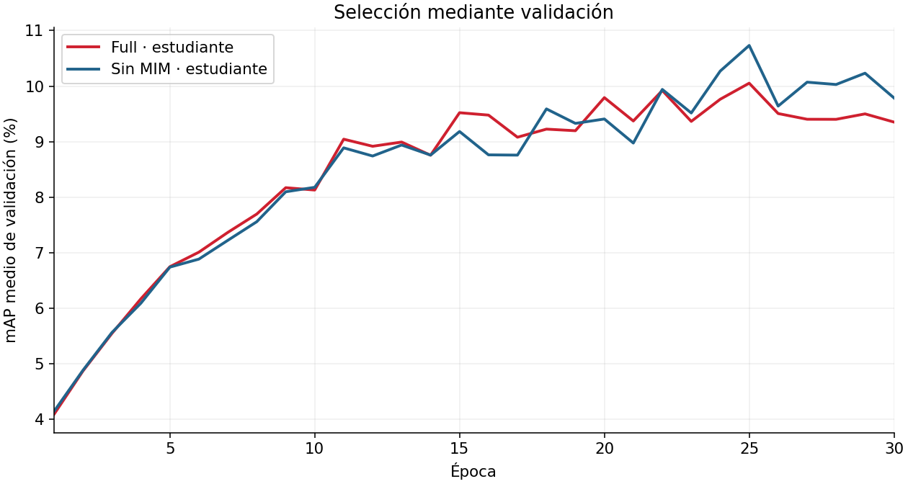
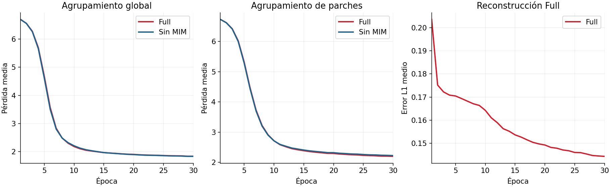
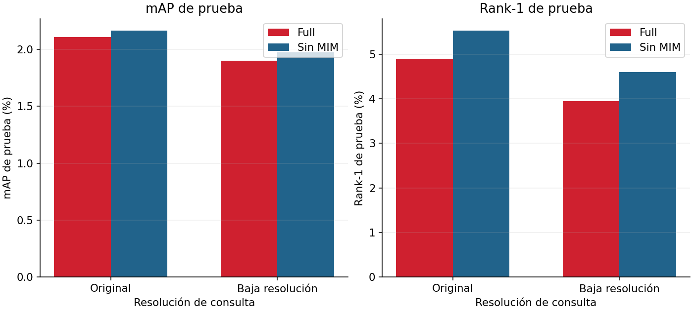

# Resultados del experimento y evidencia de ejecución

## Alcance

Se entrenaron Full y Sin MIM con la misma configuración común y semilla 42. Cada ejecución completó 30 épocas y 2 580 pasos, dentro de un calendario original de 40 épocas. La parada fue operativa, no una terminación temprana automática. Los resultados siguientes se calcularon con los pesos seleccionados por validación; testing no seleccionó el codificador ni actualizó los parámetros.

## Evolución de validación

Los estudiantes alcanzaron sus mejores puntuaciones de validación en la época 25: Full 10.052 % y Sin MIM 10.732 %. El criterio es la media de mAP original y de baja resolución. Los valores máximos y la época seleccionada no deben confundirse con la última época entrenada.

## Pérdidas de entrenamiento

Los términos de agrupamiento descienden y sus curvas son similares entre variantes. El error L1 de reconstrucción de Full también disminuye. Esto evidencia avance de la optimización, pero no demuestra una mejora de recuperación: Sin MIM obtuvo métricas de prueba ligeramente superiores. La pérdida total puede ser negativa por los términos de entropía negativa de ME-MAX; comparar totales con objetivos diferentes no mide directamente qué modelo recupera mejor.

## Evaluación final: maestro y estudiante

Todas las métricas se expresan en porcentaje. Las 3 368 consultas fueron válidas en cada condición; la galería bruta contiene 19 732 imágenes y se filtra por consulta.

| Arquitectura | Codificador | Condición | mAP (%) | Rank-1 (%) | Rank-5 (%) | Rank-10 (%) |
|---|---|---|---:|---:|---:|---:|
| Full | Maestro | Original | 1.959 | 4.276 | 12.055 | 17.310 |
| Full | Maestro | Baja resolución | 1.780 | 3.949 | 10.570 | 14.667 |
| Full | Estudiante | Original | 2.110 | 4.899 | 12.559 | 18.141 |
| Full | Estudiante | Baja resolución | 1.899 | 3.949 | 11.461 | 15.736 |
| Sin MIM | Maestro | Original | 2.081 | 5.463 | 12.886 | 17.369 |
| Sin MIM | Maestro | Baja resolución | 1.876 | 4.216 | 11.223 | 15.707 |
| Sin MIM | Estudiante | Original | 2.162 | 5.523 | 13.450 | 18.379 |
| Sin MIM | Estudiante | Baja resolución | 1.975 | 4.602 | 12.084 | 16.865 |

La validación eligió al estudiante en ambas arquitecturas. Sin MIM supera a Full en las cuatro métricas y las dos resoluciones para los estudiantes. Los maestros también se evaluaron; no se escogieron retrospectivamente usando testing.

El mAP de Full disminuye 0.211 puntos porcentuales al reducir la resolución y el de Sin MIM disminuye 0.188. La pérdida de resolución perjudica las métricas agregadas de ambos modelos. Las diferencias entre variantes son pequeñas y proceden de una ejecución por variante; no demuestran significancia estadística ni una conclusión general contra MIM.

## Aciertos y fallos

- [Full: cinco aciertos y cinco fallos por resolución](resultados_full.md).
- [Sin MIM: cinco aciertos y cinco fallos por resolución](resultados_no_mim.md).

## Configuraciones y trazabilidad

Las configuraciones efectivas y los resúmenes se conservan en [Full](experimentos/full/config.yaml) y [Sin MIM](experimentos/no_mim/config.yaml), junto con métricas del maestro y del estudiante, metadatos y resúmenes. Se conserva también la [tabla original de prueba](experimentos/testing_comparison.csv) y el [manifiesto de selección](experimentos/selection_manifest.json). Las rutas Linux de esos archivos corresponden a la ejecución original.

Los archivos comparativos iniciales de `configs/` son plantillas; contienen presupuestos sin fijar y no son las configuraciones de las corridas publicadas. Para reproducir el experimento, parte de las configuraciones efectivas, conserva los hiperparámetros, adapta las rutas de datos y salida a tu equipo y ejecuta con `--max-epochs-per-invocation 30` sobre el calendario de 40. No cambies retrospectivamente los registros históricos. Los datos HDF5 y checkpoints se distribuyen por separado del código.

## Modelo base y ablación en esta entrega

El modelo base o de referencia del diseño experimental es **Full**, que conserva los componentes centrales del método del artículo adaptados a reidentificación. La comparación de ablación retira el objetivo de reconstrucción y vuelve a entrenar la variante **Sin MIM** con la configuración común. Ambos modelos tienen entrenamiento y evaluación final documentados.

El identificador interno `baseline` del código corresponde a otra variante de agrupamiento global y no se utiliza para denominar el modelo base de esta entrega. Se mantienen los nombres de código y los registros históricos sin cambios: no se atribuyen resultados a una ejecución de esa variante. Maestro y estudiante son los dos codificadores del mecanismo de aprendizaje, no los nombres de la comparación Full/Sin MIM.

## Interpretación

La implementación produjo entrenamientos y evaluaciones completos para el alcance ejecutado. La precisión de recuperación es baja y hay confusiones entre identidades de apariencia similar. El artículo original evalúa otras tareas y presupuestos; sus métricas no son un objetivo numérico directamente comparable al mAP de reidentificación de este laboratorio.
