# Recuperaciones de prueba: Full

## Procedencia y lectura de los paneles

Estos veinte ejemplos corresponden al **estudiante de Full**, seleccionado mediante validación y evaluado en `testing.h5`. Los pesos seleccionados son de la época 25 de una ejecución de 30 épocas. Se muestran cinco aciertos y cinco fallos en cada resolución.

Cada panel contiene una consulta y cuatro resultados de galería, de izquierda a derecha y en orden de similitud. No es una secuencia de video. `+` indica la misma identidad según las etiquetas de evaluación y `−` una identidad diferente. La similitud coseno no es una probabilidad de acierto.

Un acierto significa que el primer candidato es correcto (Rank-1); no exige que los cuatro sean correctos. Un fallo significa que el primero es incorrecto; la persona buscada puede aparecer más abajo. La posición de la primera coincidencia procede del registro de evaluación y puede superar los cuatro resultados visibles.

Las consultas originales tienen 128 × 64 píxeles. Las consultas reducidas parten de 32 × 16 y se redimensionan al tamaño de entrada del codificador; la galería permanece en resolución original. Ambos grupos utilizan los mismos pesos.

Los casos son los primeros disponibles de cada categoría según el orden de consultas: no son una muestra aleatoria ni un cálculo adicional de las métricas. Los grupos de aciertos originales y reducidos pueden contener consultas distintas. Las observaciones visuales describen patrones compatibles con los errores, sin atribuir causalidad a un color, objeto o fondo.

## Resolución original: cinco aciertos

### Acierto 1 · consulta 1

**Registro:** primera coincidencia correcta en el puesto **1**; similitud del primer resultado **0.9657**.

La primera imagen recuperada corresponde a la misma identidad y a una cámara diferente. Es una recuperación correcta en Rank-1, Rank-5 y Rank-10; la presencia de otros candidatos incorrectos no invalida este acierto.

### Acierto 2 · consulta 6

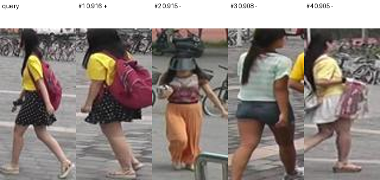

**Registro:** primera coincidencia correcta en el puesto **1**; similitud del primer resultado **0.9162**.

La primera imagen recuperada corresponde a la misma identidad y a una cámara diferente. Es una recuperación correcta en Rank-1, Rank-5 y Rank-10; la presencia de otros candidatos incorrectos no invalida este acierto.

### Acierto 3 · consulta 9

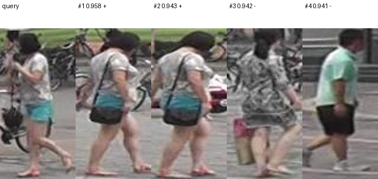

**Registro:** primera coincidencia correcta en el puesto **1**; similitud del primer resultado **0.9581**.

La primera imagen recuperada corresponde a la misma identidad y a una cámara diferente. Es una recuperación correcta en Rank-1, Rank-5 y Rank-10; la presencia de otros candidatos incorrectos no invalida este acierto.

### Acierto 4 · consulta 25

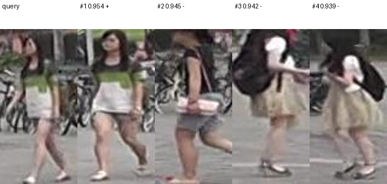

**Registro:** primera coincidencia correcta en el puesto **1**; similitud del primer resultado **0.9538**.

La primera imagen recuperada corresponde a la misma identidad y a una cámara diferente. Es una recuperación correcta en Rank-1, Rank-5 y Rank-10; la presencia de otros candidatos incorrectos no invalida este acierto.

### Acierto 5 · consulta 36

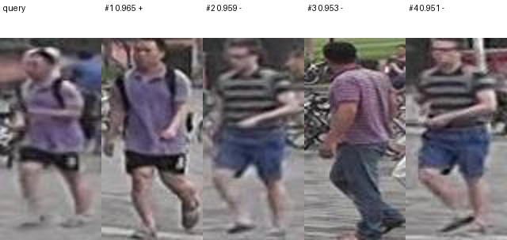

**Registro:** primera coincidencia correcta en el puesto **1**; similitud del primer resultado **0.9649**.

La primera imagen recuperada corresponde a la misma identidad y a una cámara diferente. Es una recuperación correcta en Rank-1, Rank-5 y Rank-10; la presencia de otros candidatos incorrectos no invalida este acierto.

## Resolución original: cinco fallos

### Fallo 1 · consulta 0

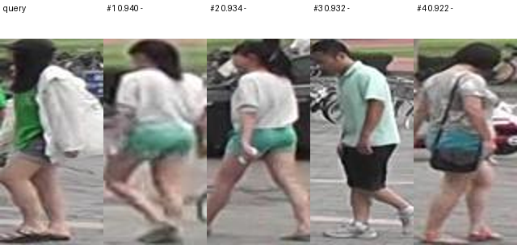

**Registro:** primera coincidencia correcta en el puesto **48**; similitud del primer resultado **0.9396**.

La consulta muestra una prenda clara sobre ropa verde; los candidatos incluyen combinaciones de colores parecidas, aunque pertenecen a otras identidades. El parecido de vestimenta no basta para resolver la consulta. La primera coincidencia ocupa el puesto 48, por lo que esta consulta falla también en Rank-5 y Rank-10. No se muestra una coincidencia correcta entre los cuatro candidatos del panel.

### Fallo 2 · consulta 2

**Registro:** primera coincidencia correcta en el puesto **223**; similitud del primer resultado **0.9793**.

Predominan camisetas amarillas, prendas oscuras y mochilas, con bicicletas en varias imágenes. La similitud de apariencia y entorno coincide con una confusión entre identidades; el panel no demuestra por sí solo qué señal causó el error. La primera coincidencia ocupa el puesto 223, por lo que esta consulta falla también en Rank-5 y Rank-10. No se muestra una coincidencia correcta entre los cuatro candidatos del panel.

### Fallo 3 · consulta 3

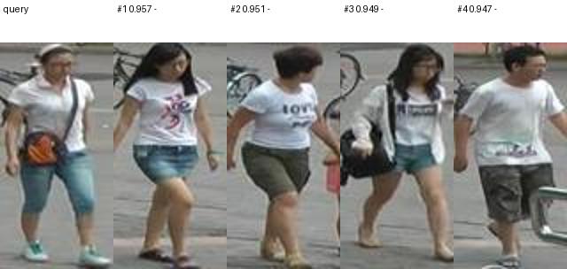

**Registro:** primera coincidencia correcta en el puesto **1481**; similitud del primer resultado **0.9574**.

La consulta combina camiseta clara, pantalón corto y un bolso cruzado. Se recuperan otras personas con prendas claras y pantalón corto; las diferencias de identidad no quedan suficientemente separadas en la clasificación. La primera coincidencia ocupa el puesto 1481, por lo que esta consulta falla también en Rank-5 y Rank-10. No se muestra una coincidencia correcta entre los cuatro candidatos del panel.

### Fallo 4 · consulta 4

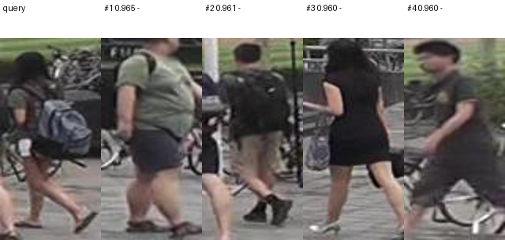

**Registro:** primera coincidencia correcta en el puesto **41**; similitud del primer resultado **0.9649**.

La consulta contiene una mochila y ropa oscura, con postura lateral o de espaldas. Entre los candidatos aparecen mochilas y prendas de tonos próximos. El resultado evidencia confusión ante apariencias parecidas y cambios de punto de vista. La primera coincidencia ocupa el puesto 41, por lo que esta consulta falla también en Rank-5 y Rank-10. No se muestra una coincidencia correcta entre los cuatro candidatos del panel.

### Fallo 5 · consulta 5

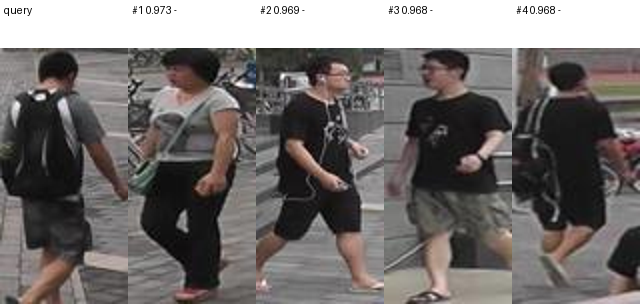

**Registro:** primera coincidencia correcta en el puesto **421**; similitud del primer resultado **0.9735**.

La consulta y varios candidatos comparten prendas negras o grises y pantalones cortos. La semejanza de indumentaria se acompaña de puntuaciones altas para identidades incorrectas. La primera coincidencia ocupa el puesto 421, por lo que esta consulta falla también en Rank-5 y Rank-10. No se muestra una coincidencia correcta entre los cuatro candidatos del panel.

## Baja resolución: cinco aciertos

### Acierto 1 · consulta 6

**Registro:** primera coincidencia correcta en el puesto **1**; similitud del primer resultado **0.9165**.

La primera imagen recuperada corresponde a la misma identidad y a una cámara diferente. Es una recuperación correcta en Rank-1, Rank-5 y Rank-10; la presencia de otros candidatos incorrectos no invalida este acierto.

### Acierto 2 · consulta 7

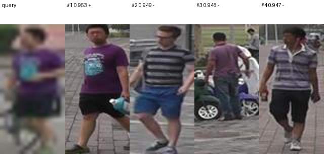

**Registro:** primera coincidencia correcta en el puesto **1**; similitud del primer resultado **0.9529**.

La primera imagen recuperada corresponde a la misma identidad y a una cámara diferente. Es una recuperación correcta en Rank-1, Rank-5 y Rank-10; la presencia de otros candidatos incorrectos no invalida este acierto.

### Acierto 3 · consulta 18

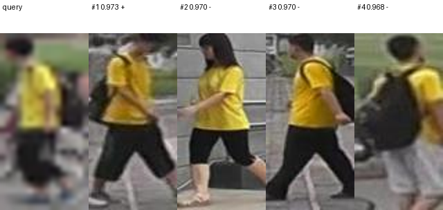

**Registro:** primera coincidencia correcta en el puesto **1**; similitud del primer resultado **0.9734**.

La primera imagen recuperada corresponde a la misma identidad y a una cámara diferente. Es una recuperación correcta en Rank-1, Rank-5 y Rank-10; la presencia de otros candidatos incorrectos no invalida este acierto.

### Acierto 4 · consulta 59

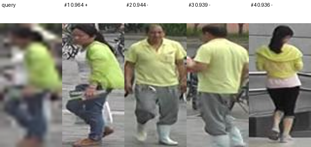

**Registro:** primera coincidencia correcta en el puesto **1**; similitud del primer resultado **0.9642**.

La primera imagen recuperada corresponde a la misma identidad y a una cámara diferente. Es una recuperación correcta en Rank-1, Rank-5 y Rank-10; la presencia de otros candidatos incorrectos no invalida este acierto.

### Acierto 5 · consulta 65

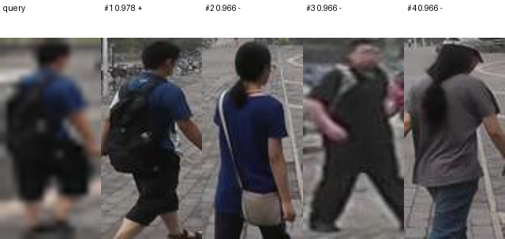

**Registro:** primera coincidencia correcta en el puesto **1**; similitud del primer resultado **0.9776**.

La primera imagen recuperada corresponde a la misma identidad y a una cámara diferente. Es una recuperación correcta en Rank-1, Rank-5 y Rank-10; la presencia de otros candidatos incorrectos no invalida este acierto.

## Baja resolución: cinco fallos

### Fallo 1 · consulta 0

**Registro:** primera coincidencia correcta en el puesto **43**; similitud del primer resultado **0.9361**.

La consulta muestra una prenda clara sobre ropa verde; los candidatos incluyen combinaciones de colores parecidas, aunque pertenecen a otras identidades. El parecido de vestimenta no basta para resolver la consulta. La consulta reducida pierde detalles finos de ropa y accesorios, aunque eso no prueba que la reducción sea la única causa de este fallo. La primera coincidencia ocupa el puesto 43, por lo que esta consulta falla también en Rank-5 y Rank-10. No se muestra una coincidencia correcta entre los cuatro candidatos del panel.

### Fallo 2 · consulta 1

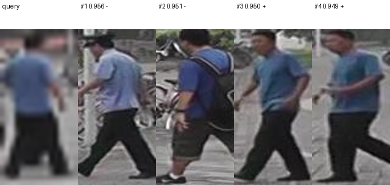

**Registro:** primera coincidencia correcta en el puesto **3**; similitud del primer resultado **0.9557**.

Los candidatos comparten prendas azules y pantalones oscuros; algunos también muestran una mochila. El modelo coloca identidades distintas por delante de la correcta pese al parecido visual. La consulta reducida pierde detalles finos de ropa y accesorios, aunque eso no prueba que la reducción sea la única causa de este fallo. La identidad correcta aparece en el puesto 3: falla Rank-1, pero esta consulta sí es un acierto en Rank-5 y Rank-10.

### Fallo 3 · consulta 2

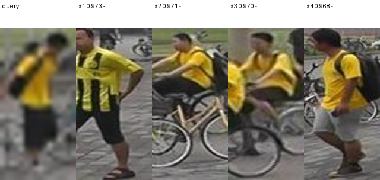

**Registro:** primera coincidencia correcta en el puesto **227**; similitud del primer resultado **0.9731**.

Predominan camisetas amarillas, prendas oscuras y mochilas, con bicicletas en varias imágenes. La similitud de apariencia y entorno coincide con una confusión entre identidades; el panel no demuestra por sí solo qué señal causó el error. La consulta reducida pierde detalles finos de ropa y accesorios, aunque eso no prueba que la reducción sea la única causa de este fallo. La primera coincidencia ocupa el puesto 227, por lo que esta consulta falla también en Rank-5 y Rank-10. No se muestra una coincidencia correcta entre los cuatro candidatos del panel.

### Fallo 4 · consulta 3

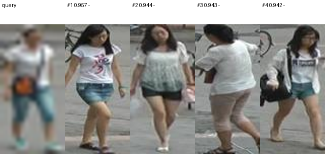

**Registro:** primera coincidencia correcta en el puesto **1589**; similitud del primer resultado **0.9573**.

La consulta combina camiseta clara, pantalón corto y un bolso cruzado. Se recuperan otras personas con prendas claras y pantalón corto; las diferencias de identidad no quedan suficientemente separadas en la clasificación. La consulta reducida pierde detalles finos de ropa y accesorios, aunque eso no prueba que la reducción sea la única causa de este fallo. La primera coincidencia ocupa el puesto 1589, por lo que esta consulta falla también en Rank-5 y Rank-10. No se muestra una coincidencia correcta entre los cuatro candidatos del panel.

### Fallo 5 · consulta 4

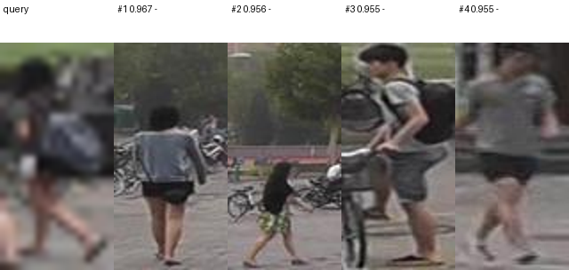

**Registro:** primera coincidencia correcta en el puesto **161**; similitud del primer resultado **0.9667**.

La consulta contiene una mochila y ropa oscura, con postura lateral o de espaldas. Entre los candidatos aparecen mochilas y prendas de tonos próximos. El resultado evidencia confusión ante apariencias parecidas y cambios de punto de vista. La consulta reducida pierde detalles finos de ropa y accesorios, aunque eso no prueba que la reducción sea la única causa de este fallo. La primera coincidencia ocupa el puesto 161, por lo que esta consulta falla también en Rank-5 y Rank-10. No se muestra una coincidencia correcta entre los cuatro candidatos del panel.

## Interpretación conjunta

Los aciertos confirman que el modelo resuelve algunas consultas entre cámaras. Los fallos muestran que una similitud alta puede asignarse a otra identidad, especialmente cuando coinciden la vestimenta y la apariencia general. Las pérdidas de entrenamiento descendieron, pero las representaciones no separan suficientemente a todas las personas.

Los ejemplos individuales no demuestran superioridad entre modelos. Esa comparación corresponde a las métricas del conjunto completo: en estas ejecuciones, el estudiante Sin MIM supera al estudiante Full en mAP y Rank-1/5/10, tanto con resolución original como reducida. La reducción de resolución disminuye las métricas agregadas de ambos.

Fuente: evaluación final `testing30_59085`; configuraciones y registros de la campaña `staged_20261029_052556`. No se han vuelto a entrenar modelos ni recalculado predicciones para preparar esta documentación.
